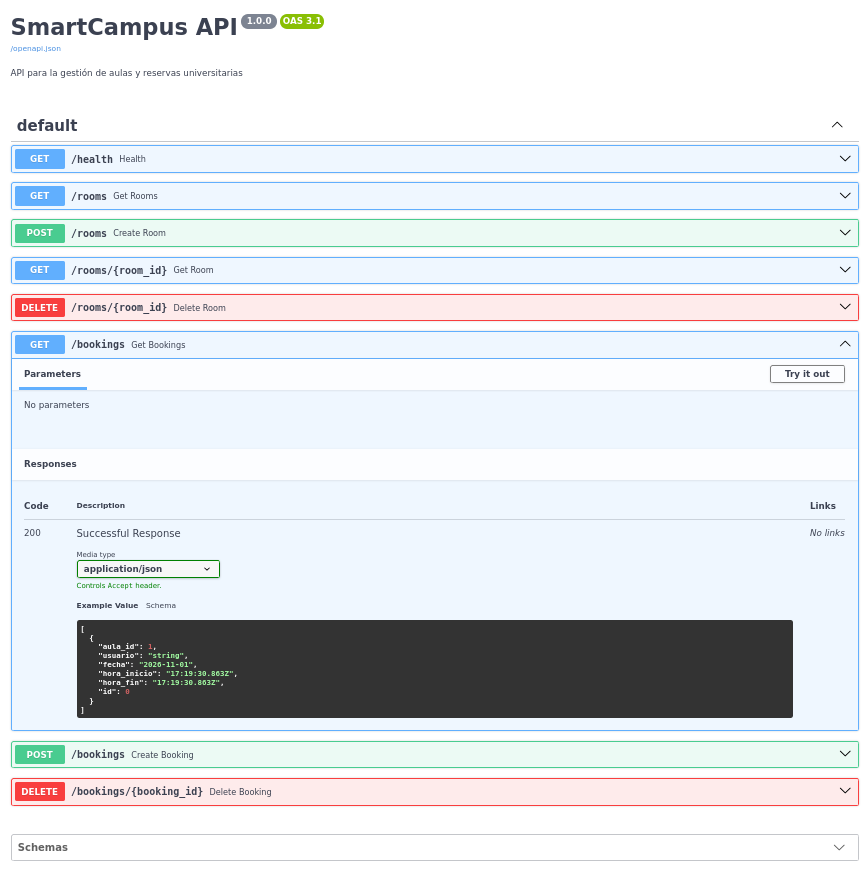
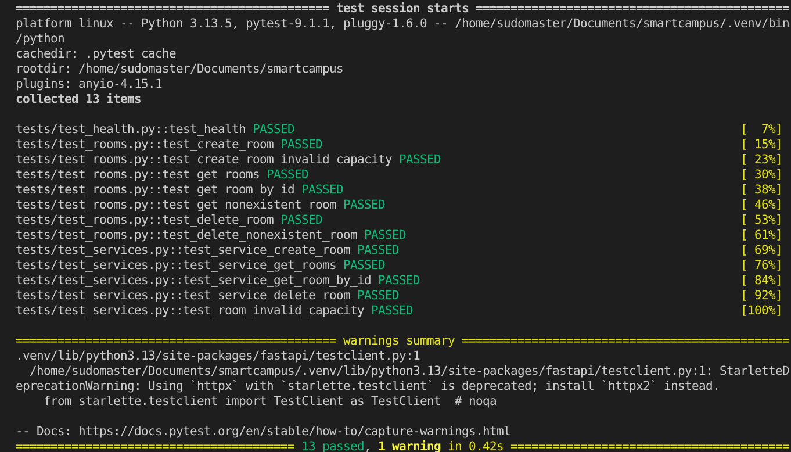
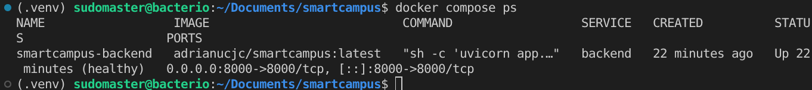
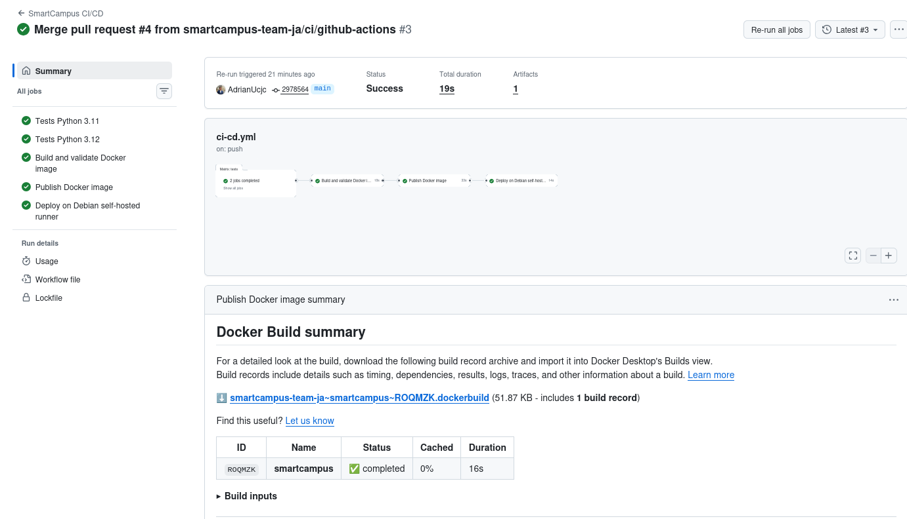
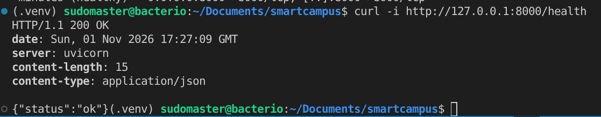
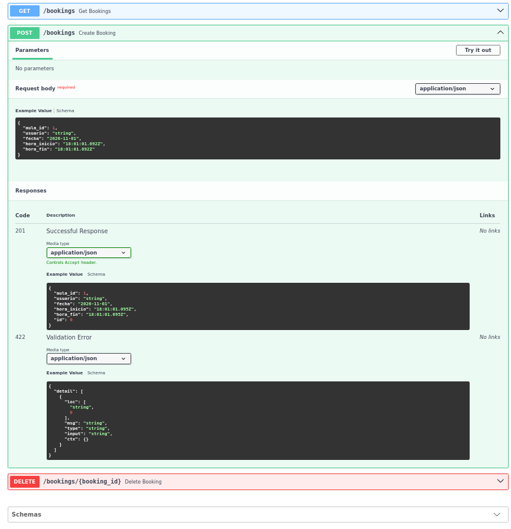
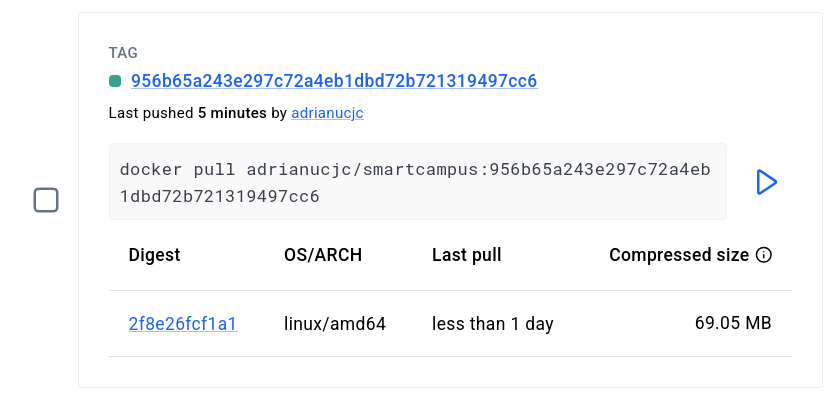
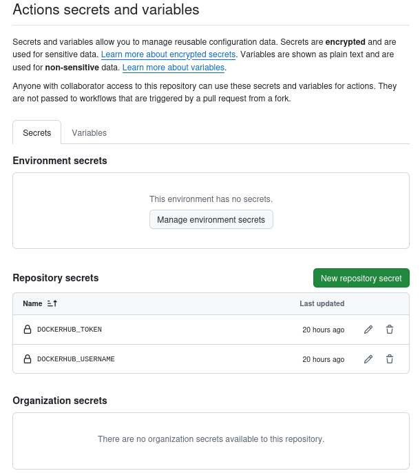
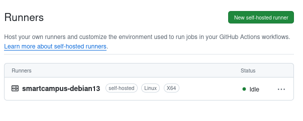

# SmartCampus

SmartCampus es una API desarrollada con **FastAPI** para la gestión de aulas universitarias y sus reservas.

## Tecnologías utilizadas

- Python
- FastAPI
- SQLAlchemy
- SQLite
- Pytest
- Ruff
- Docker y Docker Compose
- Git y GitHub Actions

## Instalación y ejecución local

Clonar el repositorio:

```bash
git clone https://github.com/smartcampus-team-ja/smartcampus.git
cd smartcampus
```

Crear y activar un entorno virtual:

```bash
python -m venv .venv
source .venv/bin/activate
```

En Windows, activar el entorno con:

```powershell
.venv\Scripts\Activate.ps1
```

Instalar las dependencias:

```bash
pip install -r requirements.txt
```

Iniciar la aplicación:

```bash
uvicorn app.main:app --reload
```

La API estará disponible en:

- Aplicación: `http://127.0.0.1:8000`
- Documentación Swagger: `http://127.0.0.1:8000/docs`
- Estado de la API: `http://127.0.0.1:8000/health`

## Gestión de aulas

La aplicación permite gestionar las aulas universitarias mediante los siguientes endpoints:

| Método | Endpoint | Descripción |
|---|---|---|
| `POST` | `/rooms` | Crear un aula |
| `GET` | `/rooms` | Consultar todas las aulas |
| `GET` | `/rooms/{id}` | Consultar un aula por ID |
| `DELETE` | `/rooms/{id}` | Eliminar un aula |

## Gestión de reservas

La aplicación permite gestionar las reservas de las aulas universitarias.

### Endpoints

| Método | Endpoint | Descripción |
|---|---|---|
| `GET` | `/bookings` | Consultar las reservas |
| `POST` | `/bookings` | Crear una reserva |
| `DELETE` | `/bookings/{booking_id}` | Eliminar una reserva |

### Reglas de negocio

- No se puede reservar un aula inexistente.
- La hora de inicio debe ser anterior a la hora de finalización.
- No se permiten reservas solapadas para la misma aula y fecha.
- Se permiten reservas consecutivas, siempre que no exista solapamiento.
- No se puede eliminar una reserva inexistente.

### Evidencia de la API

La documentación interactiva permite consultar y probar los endpoints de aulas y reservas mediante Swagger.

**EVIDENCIA 1 — Swagger con los endpoints de reservas**




## Tests

El proyecto utiliza Pytest para ejecutar pruebas automáticas.

Se han implementado tests unitarios y tests de integración.

### Tests de integración

Los tests de integración comprueban los endpoints HTTP de la aplicación, incluyendo:

- `GET /health`
- `POST /rooms`
- `GET /rooms`
- `GET /rooms/{id}`
- `DELETE /rooms/{id}`
- `GET /bookings`
- `POST /bookings`
- `DELETE /bookings/{booking_id}`

También se comprueban diferentes casos de error y las reglas de negocio de las reservas.

### Tests unitarios

Los tests unitarios comprueban directamente la lógica de los servicios de la aplicación, incluyendo las operaciones de gestión de aulas y reservas y sus validaciones.

Para ejecutar todos los tests:

```bash
python -m pytest -v
```

Para comprobar la calidad del código con Ruff:

```bash
ruff check .
```

**EVIDENCIA 2 — Ejecución correcta de los tests**




## Git Hooks

El proyecto utiliza Git Hooks para automatizar comprobaciones durante el desarrollo.

Los hooks se encuentran en:

```text
.githooks/
```

Para indicar a Git que utilice esta carpeta:

```bash
git config core.hooksPath .githooks
```

### Pre-commit

Se ejecuta automáticamente antes de realizar un commit.

Realiza las siguientes comprobaciones:

- Ejecuta Ruff para comprobar la calidad del código.
- Ejecuta los tests unitarios.
- Si alguna comprobación falla, el commit es rechazado.

### Post-commit

Se ejecuta después de realizar correctamente un commit.

Genera localmente el archivo:

```text
commit-log.txt
```

El registro contiene:

- Autor.
- Fecha.
- Hash del commit.
- Mensaje del commit.

El archivo `commit-log.txt` está incluido en `.gitignore` y no se almacena en el repositorio.

### Pre-push

Se ejecuta automáticamente antes de realizar un push.

Ejecuta los tests del proyecto mediante:

```bash
python -m pytest -v
```

Si algún test falla, el push es rechazado.

### Post-push

Git no dispone de un hook estándar nativo llamado `post-push`.

Para implementar este comportamiento se utiliza:

```text
.githooks/post-push
```

junto con el script:

```text
scripts/push.sh
```

El script realiza el `git push` y, si finaliza correctamente, ejecuta el script `post-push`.

Para utilizar el flujo completo en Windows:

```powershell
& "C:\Program Files\Git\bin\sh.exe" scripts/push.sh
```

Después de un push correcto se muestra:

```text
Cambios enviados correctamente al repositorio remoto.
```

## Docker

La aplicación puede ejecutarse dentro de un contenedor Docker.

El proyecto utiliza una imagen basada en Python y ejecuta la aplicación FastAPI mediante Uvicorn.

### Construir la imagen

```bash
docker build -t smartcampus .
```

### Docker Compose

El proyecto incluye un archivo `docker-compose.yml` que permite iniciar la aplicación de forma automatizada.

Para construir e iniciar el servicio:

```bash
docker compose up --build
```

Para ejecutarlo en segundo plano:

```bash
docker compose up -d
```

Para detener los contenedores:

```bash
docker compose down
```

### Servicio backend

Docker Compose define el servicio `backend`, encargado de ejecutar la API SmartCampus.

La aplicación queda disponible en:

```text
http://127.0.0.1:8000
```

La documentación Swagger está disponible en:

```text
http://127.0.0.1:8000/docs
```

### Healthcheck

Docker Compose incluye un `healthcheck` que consulta periódicamente el endpoint `/health`.

El estado del contenedor puede comprobarse mediante:

```bash
docker compose ps
```

Cuando la aplicación funciona correctamente, el contenedor aparece con estado:

```text
healthy
```

**EVIDENCIA 3 — Contenedor Docker funcionando**




### Persistencia

La aplicación utiliza SQLite y un volumen Docker para conservar la base de datos aunque el contenedor sea eliminado y creado de nuevo.

### Variables de entorno

El archivo `.env.example` contiene las variables de configuración:

```env
APP_ENV=development
DATABASE_URL=sqlite:////data/smartcampus.db
HOST=0.0.0.0
PORT=8000
```

## Integración continua y despliegue (CI/CD)

El proyecto utiliza **GitHub Actions** para automatizar las comprobaciones, la construcción de la imagen Docker, su publicación y el despliegue.

El flujo de CI/CD contempla las siguientes etapas:

1. **Tests:** ejecución de Ruff y Pytest con Python 3.11 y 3.12.
2. **Docker Build:** construcción y validación de la imagen Docker.
3. **Publicación:** publicación de la imagen en Docker Hub cuando se actualiza la rama `main`.
4. **Despliegue:** actualización de la aplicación en el servidor Debian mediante un runner autoalojado (*self-hosted runner*).

La publicación de la imagen y el despliegue utilizan los secretos configurados en GitHub Actions, evitando almacenar credenciales directamente en el código.

### Evidencia de GitHub Actions

**EVIDENCIA 4 — Pipeline completado correctamente**



### Evidencia del despliegue en Debian

El despliegue se realiza en el servidor Debian mediante el runner autoalojado y Docker Compose.

**EVIDENCIA 5 — Aplicación desplegada y funcionando**



## Repositorio

Código fuente del proyecto:

[SmartCampus en GitHub](https://github.com/smartcampus-team-ja/smartcampus)


## Evidencias adicionales

Se incluyen las siguientes capturas para documentar aspectos específicos de la configuración y el funcionamiento del proyecto:

### 1. Validación de reservas solapadas

La captura muestra cómo la API rechaza una reserva cuando existe otra reserva para la misma aula y en una franja horaria coincidente, devolviendo el código HTTP `409 Conflict`.



### 2. Publicación de la imagen en Docker Hub

Se muestra la imagen Docker del proyecto publicada correctamente en Docker Hub, con la etiqueta `latest`.



### 3. Configuración de secretos de GitHub Actions

La captura muestra los nombres de los secretos configurados en GitHub Actions (`DOCKERHUB_USERNAME` y `DOCKERHUB_TOKEN`). Por seguridad, no se muestran sus valores.



### 4. Estado del runner autoalojado

Se muestra el runner autoalojado de GitHub Actions registrado, preparado para ejecutar los trabajos de despliegue en el servidor Debian.

